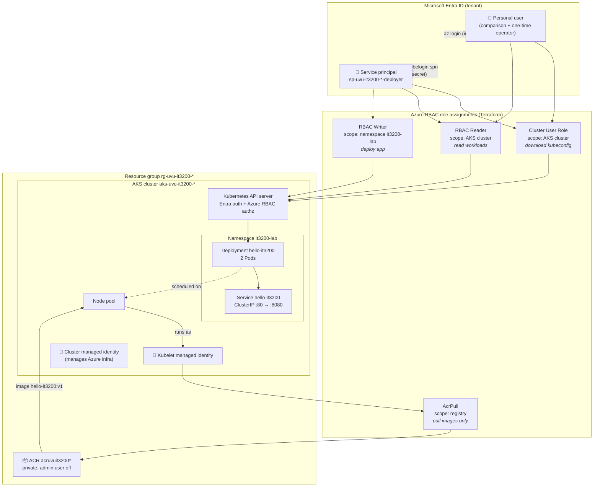

# Architecture

Two access paths run through this design. The **service principal** talks to the Kubernetes API. The **kubelet managed identity** pulls images from ACR. A role on one does nothing for the other.

## Reading the diagram

1. **Sign-in.** Every caller proves who it is to Entra ID. A person signs in through a browser; the service principal signs in with a client secret.
2. **Authorization.** Azure RBAC decides what the caller may do. *Cluster User Role* only lets you download the kubeconfig. The *RBAC Reader/Writer* roles decide what you may do inside Kubernetes.
3. **Deployment.** The service principal creates the Deployment and Service in `it3200-lab`, the only namespace where it can write.
4. **Image pull.** Each node's kubelet signs in to ACR as the kubelet managed identity. Its *AcrPull* role lets it download images and nothing else.

## Flows in plain words

| Flow | Who | Proves identity with | Allowed by |
|---|---|---|---|
| Get kubeconfig | Service principal or user | Entra token | Cluster User Role on the cluster |
| Read/write Kubernetes objects | Service principal or user | Entra token via kubelogin | AKS RBAC Reader / Writer |
| Pull image | Kubelet identity | Managed identity token (no secret) | AcrPull on the registry |
| Manage Azure infra (load balancers, disks) | Cluster identity | Managed identity token | Roles AKS assigns on the node resource group |
