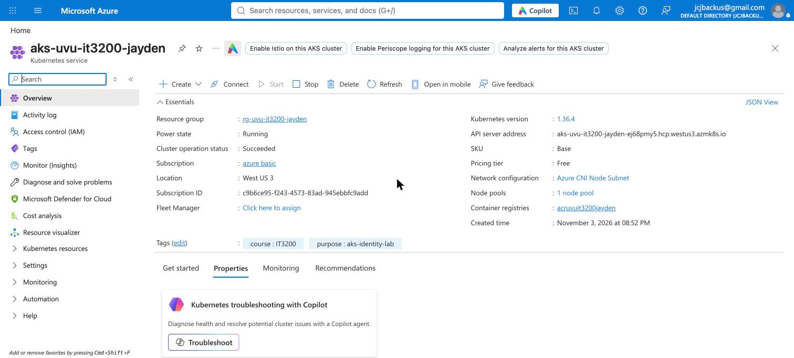
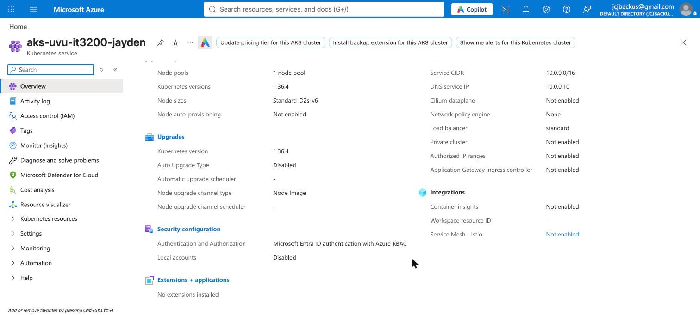
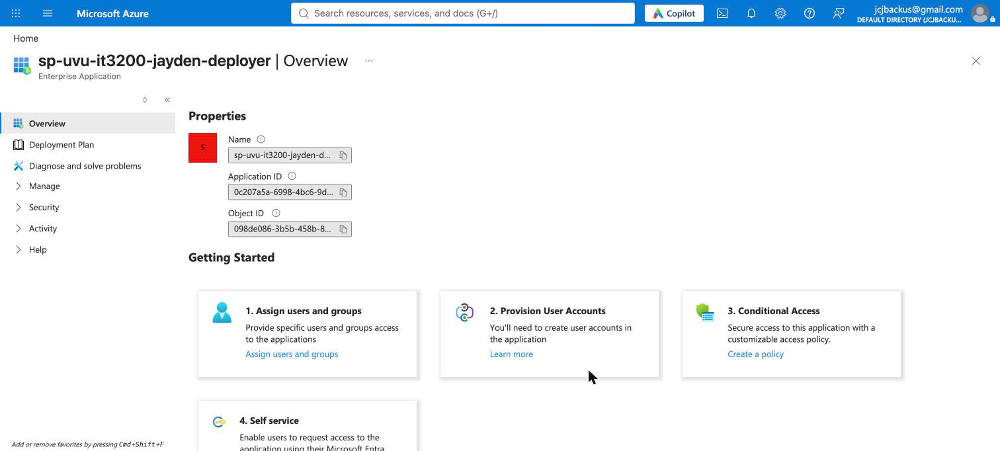
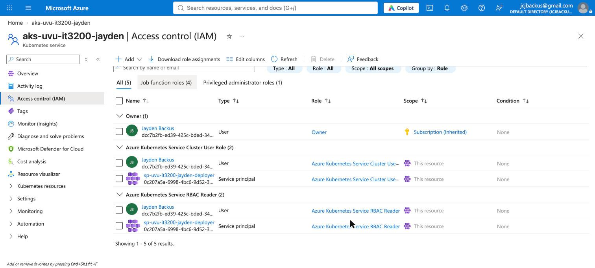
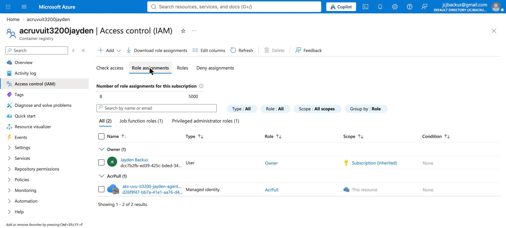
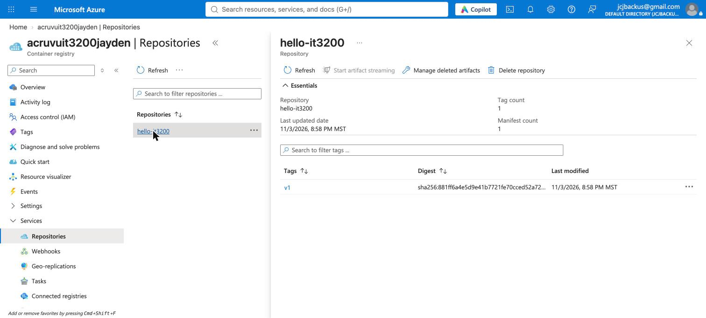
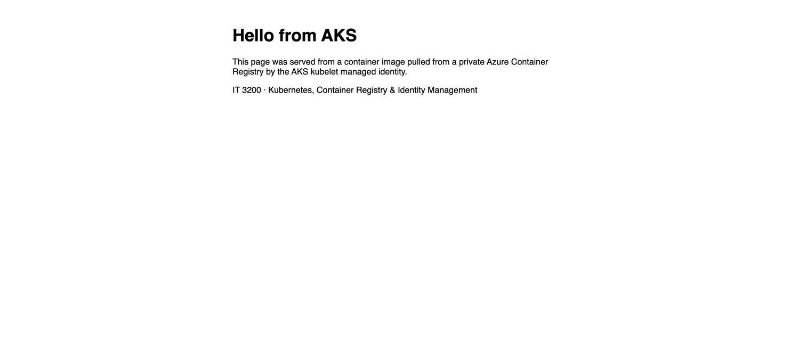

# Technical Report: Secure AKS with Terraform, Entra ID, and RBAC

**Course:** IT 3200 Cloud Computing
**Author:** Jayden Backus
**Repository:** https://github.com/jaydenbackus/uvu-it3200-terraform-aks-identity

> Command output from the live run on 2026-11-04 is saved in [`docs/evidence/`](evidence/). Portal screenshots are in [`docs/screenshots/`](screenshots/). No secret appears in either.

## 1. Executive summary

I built an AKS cluster and a private container registry with Terraform, then gave each identity only the access its job needs. A service principal deploys the app into one namespace and nothing else. The nodes pull images with their own managed identity, which may pull but never push. No one holds a static admin password: the cluster's local accounts and the registry's admin user are both off, so every request goes through Microsoft Entra ID and Azure RBAC.

The app ran from ACR on the first deploy. The problems I hit were about identity, not infrastructure: a service principal with no role cannot even see the subscription, kubelogin 0.2.22 needs IDs as flags, and new Azure RBAC roles took about three minutes to reach the cluster.

## 2. Architecture overview

See [architecture.md](architecture.md). The design has two separate access paths:

- **Control path:** person or service principal → Entra ID → Azure RBAC → Kubernetes API.
- **Image path:** node kubelet → kubelet managed identity → AcrPull → ACR.

## 3. Terraform infrastructure

| File | Contents |
|---|---|
| `versions.tf` | AzureRM 4.x, AzureAD 3.x, and Time providers |
| `variables.tf` | Names, region, node size, namespace, and lab toggles |
| `main.tf` | Resource group, ACR (Basic, admin off, anonymous pull off), AKS (system-assigned identity, Entra + Azure RBAC, local accounts off) |
| `identity.tf` | App registration, service principal, 30-day client secret |
| `rbac.tf` | Every role assignment |
| `outputs.tf` | IDs and names; the secret is marked sensitive |

Three boolean variables let me reproduce failures without editing code: `grant_sp_cluster_access`, `enable_kubelet_acr_pull`, and `grant_user_bootstrap_admin`.

**"Private" registry.** The registry rejects anonymous pulls and has no admin password, so only Entra identities with an RBAC role can read it. It still has a public endpoint; a private endpoint would need the Premium SKU and a VNet, which costs more than this lab warrants.

The first `terraform apply` created 10 resources in about 6 minutes ([01](evidence/01-terraform-apply.txt)). AKS reports `enableAzureRbac: true`, `managed: true`, and `localAccountsDisabled: true` ([02](evidence/02-aks-auth-config.txt)). ACR reports `adminUserEnabled: false` and `anonymousPull: false` ([04](evidence/04-acr-config.txt)).

Two settings changed from my first draft:
- `Standard_B2s` is not offered in westus3 and my B-series v2 quota was 0, so the node size is `Standard_D2s_v6`.
- AKS fills in default `upgrade_settings` on the node pool. Terraform saw that as drift and planned an in-place update on every apply, so I declared `max_surge = "10%"` to match.





## 4. Identity and access management

See [identities-and-permissions.md](identities-and-permissions.md) for the full table.

| Value | Where to find it |
|---|---|
| Tenant ID | `d5bdbd3f-1f76-429f-80f8-d015b41eb939` (`terraform output tenant_id`) |
| Application (client) ID | `0c207a5a-6998-4bc6-9d52-337e35498c14` (`terraform output sp_client_id`) |
| Service principal object ID | `098de086-3b5b-458b-8235-92bac20927b2` (`terraform output sp_object_id`) |
| Kubelet identity object ID | `60051ec7-4121-4a5c-989a-27388d8e5b9d` |

These IDs are identifiers, not credentials. Kubernetes error messages name the caller by object ID, which is how I matched each Forbidden error to an identity.

The service principal signs in with a client secret that expires after 30 days. Terraform generates it, so it sits in Terraform state; state and `tfvars` are git-ignored. In production I would replace the secret with workload identity federation (OIDC from GitHub Actions), which has no secret to leak.

**Why different identities?** Each identity does one job. A leaked deploy secret should not let an attacker pull every image or resize the cluster, and a compromised node should not be able to deploy workloads. Giving all of them the same rights would make the weakest credential as powerful as the strongest.

**Evidence:** [12-sp-role-assignments.txt](evidence/12-sp-role-assignments.txt) lists the service principal's three roles and scopes. 



The portal lists assignments at the cluster scope. The service principal's RBAC Writer role sits on the child scope `…/namespaces/it3200-lab`, so it appears in the CLI output ([12](evidence/12-sp-role-assignments.txt)) but not on this page.

## 5. AKS and ACR integration

```bash
az role assignment list --assignee "$(terraform -chdir=terraform output -raw kubelet_identity_client_id)" \
  --scope "$(az acr show -n "$ACR" --query id -o tsv)" -o table
```

**Why nodes need ACR access.** The kubelet on each node, not kubectl or the deployer, downloads the image. It authenticates as the kubelet managed identity, so that identity, and only that identity, needs AcrPull.

**Role research**

| Role | Finding |
|---|---|
| AcrPull | Pull images and read artifacts on a standard-RBAC registry. All the kubelet needs. |
| Container Registry Repository Reader | Replaces AcrPull on registries in *RBAC Registry + ABAC Repository Permissions* mode, where AcrPull is ignored. Can be limited to specific repositories with conditions. |
| AcrPush | Push and pull. Nodes never push, so this would be excess. |
| Contributor | Manage the registry resource: change SKU, settings, or delete it. Far more than pulling. |

**Investigation questions**

- *No pull permission:* the pod sits in `ErrImagePull`, then `ImagePullBackOff`. Events show `401 Unauthorized` or `failed to authorize`.
- *Auth failure vs. bad image name:* an auth failure says `unauthorized` / `401`. A wrong name or tag says `not found` / `manifest unknown`. A wrong registry hostname says `no such host`. `az acr repository show-tags` confirms whether the tag exists.
- *Why Terraform:* the assignment is reviewed in a pull request, recreated whenever the cluster is rebuilt (the kubelet identity changes), and removed on destroy. A manual assignment is forgotten, drifts, and outlives the cluster.

**Evidence:** [03-kubelet-acrpull.txt](evidence/03-kubelet-acrpull.txt) shows one assignment for the kubelet identity: `AcrPull` on `acruvuit3200jayden`. In the portal, the identity appears as `aks-uvu-it3200-jayden-agentpool`, a managed identity, with AcrPull scoped to this resource:



## 6. Service principal authentication testing

I tested the service principal in three stages, each set by Terraform.

**Stage 1: no roles at all** ([06](evidence/06-sp-no-roles.txt))

```
$ az login --service-principal --username "$AZURE_CLIENT_ID" --password "$AZURE_CLIENT_SECRET" --tenant "$AZURE_TENANT_ID"
ERROR: No subscriptions found for 0c207a5a-6998-4bc6-9d52-337e35498c14.

$ az login --service-principal ... --allow-no-subscriptions
Name                       UserType
N/A(tenant level account)  servicePrincipal

$ az aks get-credentials --subscription <sub> -g rg-uvu-it3200-jayden -n aks-uvu-it3200-jayden
ERROR: Subscription 'c9b6ce95-…' not found.
```

The first error looks like a bad login, but it isn't. Entra ID accepted the secret; the CLI then listed the subscriptions this principal can see and found none, because it had no Azure role anywhere. `--allow-no-subscriptions` proves the sign-in works.

**Stage 2: Cluster User Role only** ([08](evidence/08-sp-cluster-user-only.txt))

`az aks get-credentials` now succeeds, but every kubectl call fails:

```
Error from server (Forbidden): pods is forbidden: User "098de086-3b5b-458b-8235-92bac20927b2"
cannot list resource "pods" in API group "" in the namespace "it3200-lab":
User does not have access to the resource in Azure. Update role assignment to allow access.
```

**Diagnosis.** The service principal is valid: the API server knows its object ID, which it could only learn from a valid Entra token. Forbidden means it has no Kubernetes authorization. Cluster User Role lets it download the kubeconfig and nothing more.

**Stage 3: final roles** ([11](evidence/11-sp-final-roles.txt))

| Command | Result |
|---|---|
| `kubectl cluster-info` | OK |
| `kubectl get nodes` | **Forbidden**: nodes are cluster-scoped, and RBAC Reader/Writer do not cover them |
| `kubectl get namespaces` | OK |
| `kubectl get pods -A` | OK (Reader at cluster scope) |
| `kubectl get pods -n it3200-lab` | OK |
| `can-i create deployments -n it3200-lab` | yes |
| `can-i create deployments -n default` | no |
| `can-i create rolebindings -n it3200-lab` | no |
| `can-i delete namespaces` | no |
| `can-i get secrets -n it3200-lab` | **yes**: RBAC Writer includes Secrets in its namespace |

The new roles took about three minutes to reach the cluster. Until then the same Forbidden errors continued, and `can-i` gave mixed answers while the change spread. I confirmed the assignments existed in Azure ([12](evidence/12-sp-role-assignments.txt)) and waited instead of adding more roles.

**kubelogin finding.** The lab's `kubelogin convert-kubeconfig -l spn` failed in kubelogin 0.2.22 with `--client-id is required`, then `--tenant-id is required`, even with `AZURE_CLIENT_ID` and `AZURE_TENANT_ID` set. Passing both as flags fixed it. The secret still comes only from `AZURE_CLIENT_SECRET` at token time; the kubeconfig contains the client and tenant IDs but zero copies of the secret ([11](evidence/11-sp-final-roles.txt)).

## 7. Personal account troubleshooting comparison

Workflow followed:

1. Recorded the service principal's exact errors (Section 6).
2. Confirmed it authenticated: the CLI showed `userType: servicePrincipal`, and the Forbidden message named its object ID.
3. Listed its roles as my own account: `az role assignment list --assignee <sp_client_id> --all`.
4. Checked the cluster's mode: `az aks show` → `enableAzureRbac: true`, `disableLocalAccounts: true`. So Azure roles, not Kubernetes RoleBindings, decide access.
5. Signed in as myself and ran the same tests ([13](evidence/13-user-comparison.txt)).
6. Compared the two, then gave the service principal its final roles through Terraform and retested.

| Test | Service principal (final) | Personal account |
|---|---|---|
| Azure authentication | OK (client secret) | OK (browser + MFA; first login failed until I named the tenant) |
| Retrieve AKS credentials | OK (Cluster User Role) | OK (Cluster User Role) |
| List Kubernetes namespaces | OK | OK |
| Read Pods in lab namespace | OK | OK |
| Deploy application | **OK**: RBAC Writer on `it3200-lab` | **Forbidden**: RBAC Reader only |
| List nodes | Forbidden | Forbidden |

**Difference.** The service principal holds *RBAC Writer* on the namespace; my account holds only *RBAC Reader*. My account is **Owner of the subscription**, yet it cannot create a Deployment. Owner grants Azure management actions (`actions`), while Kubernetes requests are checked against data actions (`dataActions`), which only the AKS RBAC roles grant. Subscription Owner is not the same as cluster admin when Azure RBAC for Kubernetes is on.

**Temporary permissions.** Namespace-scoped roles cannot create the namespace they apply to. My account held *RBAC Cluster Admin* from 04:04 to 04:07 UTC, long enough to run `kubectl apply -f k8s/namespace.yaml` ([09](evidence/09-user-bootstrap-namespace.txt)). The next apply destroyed it ([10](evidence/10-apply-final-roles.txt)).

## 8. Kubernetes application deployment

```bash
scripts/build-and-push.sh
scripts/render-manifests.sh deployment.yaml service.yaml | kubectl apply -f -
kubectl get deployments,pods,services -n it3200-lab
kubectl describe pod -n it3200-lab -l app=hello-it3200
kubectl get events -n it3200-lab
kubectl port-forward -n it3200-lab svc/hello-it3200 8080:80
```

I built the image in ACR with `az acr build` (ACR Tasks worked on this subscription), giving `hello-it3200:v1` with digest `sha256:881ff6a4…` ([05](evidence/05-acr-image.txt)). The service principal then applied the manifests ([14](evidence/14-deploy-as-sp.txt)):

```
deployment.apps/hello-it3200   2/2   2   2   acruvuit3200jayden.azurecr.io/hello-it3200:v1
pod/hello-it3200-df8b5fb89-4bzjr   1/1   Running   0
pod/hello-it3200-df8b5fb89-fdk9b   1/1   Running   0
service/hello-it3200   ClusterIP   10.0.28.187   80/TCP

Normal  Pulled  kubelet  Successfully pulled image "acruvuit3200jayden.azurecr.io/hello-it3200:v1" in 1.563s
```

The `Pulled` event and the pod's `Image ID` (same digest as in ACR) prove the node pulled from my private registry. A brief `Readiness probe failed ... connection refused` warning appeared because the first probe ran before nginx was listening; the pods went Ready a second later.

`kubectl port-forward` returned `HTTP/1.1 200 OK` and the page's "Hello from AKS" heading ([15](evidence/15-app-access.txt)).

**Pod states**

| State | Meaning |
|---|---|
| `Pending` | Not yet scheduled (no node with enough CPU/memory) or waiting on volumes. |
| `ErrImagePull` | The latest pull attempt failed: auth, wrong name, or network. |
| `ImagePullBackOff` | Kubernetes is waiting longer between pull retries after repeated failures. |
| `CrashLoopBackOff` | The image pulled and the container started, but it keeps exiting. Check `kubectl logs --previous`. |





**Limits I tested** ([16](evidence/16-sp-denied-actions.txt)). As the service principal, each of these was denied:

| Request | Result |
|---|---|
| Create a Deployment in `default` | Forbidden |
| Delete namespace `it3200-lab` | Forbidden |
| Bind itself to the `admin` ClusterRole in its namespace | Forbidden (no privilege escalation) |
| List nodes | Forbidden |

## 9. Permission and security analysis

**Why namespace-scoped write but no cluster delete?** A deploy pipeline needs to ship one app. If its credential leaks, the damage should stop at that app's namespace. Deleting the cluster is an Azure control-plane action that no deploy ever needs; granting it turns a leaked CI secret into an outage.

**Dev, test, and prod design**

- One cluster per environment (or at least prod on its own), each in its own subscription or resource group.
- One deploy identity per app per environment, with RBAC Writer only on that app's namespace.
- Humans get RBAC Reader in prod; write access goes through the pipeline or through just-in-time elevation (Entra PIM) with approval.
- Access is assigned to Entra groups, not individuals, so joiners and leavers are handled in one place.
- Prod images come from a prod registry that only accepts images promoted from test.

**Hardening applied:** local accounts off, ACR admin user off, anonymous pull off, non-root container, resource limits, 30-day secret.

## 10. Troubleshooting findings

### Problems I hit

| Symptom | Evidence | Root cause | Fix |
|---|---|---|---|
| `az login` failed: `AADSTS50076 ... must use multi-factor authentication` | CLI warning named the tenant | Plain `az login` skipped the tenant that enforces MFA | `az login --tenant <id>` |
| `No subscriptions found for jcjbackus@gmail.com` | `az account list --all` showed only a tenant-level account | The account had no subscription yet | Created the subscription, then logged in again so the CLI refreshed its list |
| Every provider `NotRegistered` | `az provider show` | New subscription | `az provider register` for ContainerService, ContainerRegistry, Compute, Network, and others |
| `Standard_B2s` unavailable | `az vm list-skus`, `az vm list-usage` | SKU not offered in westus3; Bsv2 quota 0 | Switched to `Standard_D2s_v6` (Dsv6 quota 10) |
| Terraform planned an AKS update on every apply | Plan showed `upgrade_settings` → null | AKS sets defaults Terraform didn't declare | Declared `max_surge = "10%"` |
| SP `az login`: `No subscriptions found` | Same secret worked with `--allow-no-subscriptions` | Valid identity, zero Azure roles | Expected at this stage; scripts now pass the flag |
| `kubelogin ... -l spn`: `--client-id is required` | kubelogin 0.2.22 help | This version reads the IDs from flags during convert | Pass `--client-id` and `--tenant-id` |
| Kubectl as SP hit `localhost:8080` | `KUBECONFIG` empty in the next command | I piped a `source`d script, so its exports ran in a subshell | Source it on its own line |
| Forbidden after roles applied | Roles listed in Azure; `can-i` answers mixed | Propagation delay (~3 min) | Waited and retested; changed nothing |

### Scenario A — Authentication succeeds, kubectl returns Forbidden

- **Causes:** no Azure RBAC role for Kubernetes; role at the wrong scope (other namespace); role assigned to the app object instead of the service principal object; role not yet propagated; cluster uses Kubernetes RBAC so Azure roles are ignored.
- **Tools:** `az account show`, `az role assignment list --assignee <id> --all`, `kubectl auth can-i --list -n <ns>`, `az aks show --query aadProfile`.
- **Evidence:** the Forbidden message names the user (object ID), verb, and resource. Compare it with the role list.
- **Fix:** add the narrowest role that covers that verb and resource, through Terraform. Wait a few minutes, then retest.
- **Prevent:** a CI smoke test that runs `kubectl auth can-i` for each pipeline identity after every infra change.

### Scenario B — ImagePullBackOff

- **Causes:** AcrPull missing or on the wrong identity (cluster identity instead of kubelet); wrong registry, repo, or tag; registry firewall or private DNS blocking nodes; ABAC-mode registry needing Repository Reader.
- **Tools:** `kubectl describe pod`, `kubectl get events`, `az aks check-acr -g $RG -n $AKS --acr <login-server>`, `az acr repository show-tags`.
- **Evidence:** `401 Unauthorized` means permissions; `not found` means name or tag; `no such host` or timeouts mean network/DNS.
- **Fix:** assign AcrPull to the kubelet object ID at registry scope, or correct the image reference.
- **Prevent:** keep the assignment in the same Terraform module as the cluster; pin image tags; run `az aks check-acr` in the pipeline.

### Scenario C — Personal account works, service principal fails

- **Causes:** the user holds a role the service principal lacks (often inherited from subscription Owner); expired client secret; kubeconfig not converted to `spn` mode, so kubelogin still uses the user's token; env vars missing.
- **Tools:** `az role assignment list` for both identities side by side; `kubectl config view --minify` to see the kubelogin mode; Entra sign-in logs for the service principal.
- **Evidence:** a role present for one and absent for the other, or `AADSTS7000222` (expired secret).
- **Fix:** grant the missing role to the service principal in Terraform, or rotate the secret.
- **Prevent:** test with the pipeline identity, never a person's account; alert on secrets expiring within 7 days.

### Scenario D — "Give every service principal Cluster Admin"

- **Why not:** any leaked CI secret then owns every namespace, every Secret, and every RoleBinding. It removes the audit trail's meaning and breaks environment separation.
- **Instead:** find the exact verb and resource in the Forbidden error, grant that at the narrowest scope, and template the pattern so new apps get the right roles automatically.
- **Prevent:** an Azure Policy or CI check (e.g. Checkov, OPA/Conftest on the Terraform plan) that blocks Cluster Admin and Owner assignments to service principals.

### Scenario E — Terraform succeeds but the app won't start

- **Causes:** Terraform proves Azure resources exist, not that the workload runs. Image never pushed; image built for arm64 on an amd64 node (`exec format error`); container crashes; requests larger than node capacity; AcrPull not yet propagated.
- **Tools:** `kubectl get pods`, `describe`, `logs --previous`, `get events`, `kubectl top nodes`.
- **Evidence:** pod state points to the layer: `Pending` → scheduling, `ImagePullBackOff` → registry, `CrashLoopBackOff` → the app.
- **Fix:** depends on the layer; for arm64 builds, rebuild with `--platform linux/amd64`.
- **Prevent:** a post-deploy smoke test that waits on `kubectl rollout status` and curls the service before the pipeline reports success.

## 11. Bonus: break and fix

The break did not show up, and that turned out to be the lesson.

1. **Remove.** `terraform plan -var enable_kubelet_acr_pull=false` showed exactly one change, the AcrPull assignment to destroy. I applied that saved plan at 04:12 UTC ([17](evidence/17-bonus-plan-remove-acrpull.txt)).
2. **Test.** I recreated the `pull-test` pod (with `imagePullPolicy: Always`) every minute for 15 minutes. Every attempt reached `Running`, and the events show a fresh `Pulled` from ACR each time, while `az role assignment list` showed the kubelet identity holding no role at all ([18](evidence/18-bonus-pull-after-removal.txt)).
3. **Restore.** `terraform plan` showed one assignment to add; I applied it, and a new pull-test pod went `Running` in 1 second ([19](evidence/19-bonus-restore-acrpull.txt)).

**Why pulls kept working.** Removing a role does not take back credentials already issued. The node's credential provider swaps the kubelet identity's Entra token for an ACR token and caches it. ACR checks RBAC when it issues a token, not on every pull, so the cached token works until it expires (ACR refresh tokens last up to about three hours). A new node, with an empty cache, would have failed with `401 Unauthorized` → `ErrImagePull` → `ImagePullBackOff`. I did not add a second node to prove it, to keep the lab cheap.

**What this means in practice.** Revoking access is not instant. If you remove a compromised identity's role, existing tokens can keep working for hours, so incident response must also rotate credentials or replace nodes. It also means a broken role assignment can hide on old nodes and only surface when the cluster scales or upgrades, which argues for testing pulls on a fresh node in CI.

**Catching this before production:** `terraform validate` and `tflint` catch syntax; Checkov or Conftest on `terraform show -json tfplan` can require that every AKS cluster has an AcrPull assignment for its kubelet identity and forbid broad roles; and an ephemeral test environment can run `az aks check-acr` plus a real deploy and `rollout status` on each pull request.

## 12. Conclusion and lessons learned

- Authentication and authorization fail differently. A Forbidden error means the identity works but lacks a role.
- The deployer and the nodes are different identities. Granting ACR access to the wrong one changes nothing.
- `az aks get-credentials` succeeding proves only that you can download a kubeconfig.
- Role assignments take minutes to propagate; retest before changing more.
- A login error is not always an authentication error. "No subscriptions found" meant zero roles, not a bad secret.
- Subscription Owner does not make you a cluster admin when Azure RBAC for Kubernetes is on. Owner covers management actions; Kubernetes checks data actions.
- Revoking a role does not revoke tokens already issued. Image pulls kept working for 15 minutes after AcrPull was gone.
- The lab's tools changed under it: kubelogin 0.2.22 needed flags the docs describe as optional, and the default VM size wasn't offered in my region. Reading the real error beats following a guide line by line.

**At scale (100 clusters, 500 apps).** I would define clusters, registries, and identities as Terraform modules so every cluster gets the same roles by default. Each app would get its own deploy identity using workload identity federation from CI (no secrets), scoped to its namespace and environment. Access would be granted to Entra groups and reviewed regularly; prod elevation would go through PIM. A few shared registries per environment would serve many clusters, with images promoted from test to prod. GitOps (Flux or Argo CD) would apply manifests so humans rarely need write access, and policy checks in CI would block overbroad roles before they reach Azure.

**Cleanup.** `terraform plan -destroy` listed only the 13 lab resources; `terraform destroy` removed them in about 5 minutes, including the node resource group. Afterward the subscription held no lab resource group, no service principal or app registration, and no non-user role assignments. The one remaining resource group, `NetworkWatcherRG`, is the free Network Watcher Azure creates on its own ([20](evidence/20-destroy-plan.txt)). I also deleted the local service-principal CLI profile and kubeconfigs.

## 13. AI assistance

| What I asked | What it produced | How I checked it |
|---|---|---|
| Claude Code: scaffold the repo from the assignment text | Terraform, manifests, scripts, README, report outline | `terraform validate`; compared role names and AKS settings with Microsoft Learn and the Terraform registry docs; ran every command myself |
| Claude Code: deploy and test end to end | Ran Terraform plans, the SP and personal-account tests, the deploy, and the bonus; saved output to `docs/evidence/` | Every `terraform apply` ran from a saved plan I reviewed; each role grant needed my approval. I checked each claimed result against the saved output |
| Claude Code: why does `az login` as the SP say "No subscriptions found"? | Explained it as a valid sign-in with zero roles; suggested `--allow-no-subscriptions` | The flag let the same secret sign in, and the CLI then showed `userType: servicePrincipal` |
| Claude Code: why does the image still pull after removing AcrPull? | Suggested cached ACR tokens rather than a Terraform failure | Confirmed with `az role assignment list` that the role was gone while pulls continued, and that restoring it changed nothing visible |

I am responsible for the configuration and confirmed each role's permissions against Microsoft's built-in role reference before applying it.
